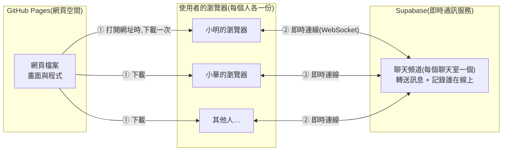

# 匿名聊天室架構文件

這份文件寫給不寫程式的人看。專有名詞第一次出現時,會用一句話解釋。文件裡沒有任何程式碼,只說明「做什麼、為什麼這樣做」。

---

## 1. 專案說明與目標

### 這是什麼

一個不用註冊、不用登入的匿名聊天室。任何拿到網址的人,用電腦或手機打開,輸入一個代號,就進到聊天室(可以選大廳、閒聊、深夜,預設是大廳;同一個聊天室裡的人看得到彼此),可以看到別人的訊息,也可以送出訊息。

### 目標

- 打開網頁、取個代號,十秒內就能開始聊天。
- 畫面上看得到誰在線上,有人進來或離開時有提示。
- 聊完就消失:訊息不保存在任何地方,新來的人看到的是空白畫面。
- 電腦和手機都好用。

### 已經和你確認過的使用規則

| 項目 | 規則 |
|---|---|
| 歷史訊息 | 不保存。新人進來是空白畫面 |
| 代號 | 1 到 12 個字,前後空格自動去掉,中文、英文、數字、emoji 都可以。線上不能重複,對方離線後別人可以用 |
| 訊息 | 純文字,最多 200 字,不能是空的。網址只顯示成文字,不能點。同一個人一秒只能送一則 |
| 送出方式 | 電腦按 Enter 送出,Shift+Enter 換行。觸控裝置(手機、平板)的 Enter 是換行,用送出按鈕送出。判斷依據是裝置有沒有觸控,不是螢幕寬度,所以電腦上把視窗縮小,仍然是 Enter 送出 |
| 線上名單 | 電腦版放在側邊。手機版平常只顯示「線上 N 人」,點開才看到名單 |
| 進出提示 | 在訊息之間插入灰色小字,例如「小明 進來了」 |
| 訊息排版 | 自己的訊息靠右,別人的靠左,顯示代號與時間,每個人有自己的顏色 |
| 重新整理或斷線 | 這個分頁記住代號,自動回到聊天室,並提示「已重新連線,中斷期間的訊息看不到」。每個分頁各記各的,互不影響。把分頁關掉再重新打開網址,要重新輸入代號 |
| 人數上限 | 每個聊天室同時最多 50 人。滿了會顯示「聊天室已滿,請稍後再來,或換一個聊天室」 |
| 管理 | 沒有管理員,不能封鎖或檢舉 |
| 捲動 | 你停在最底部時,新訊息會自動捲上來。你往上看舊訊息時,畫面不會被拉走,底部會出現「有 N 則新訊息」按鈕 |
| 分頁提示 | 切到別的分頁時,分頁標題顯示未讀數,例如「(3) 匿名聊天室」。沒有提示音 |
| 氣氛 | 深夜公共空間的感覺,只做深色版。舊訊息往上捲出畫面時漸漸變淡,呼應「會消失」 |

---

## 2. 整體架構圖

先用白話說明三個角色:

- **瀏覽器**:使用者自己的 Chrome、Safari 之類的軟體。聊天室的畫面和操作都在這裡運作。
- **GitHub Pages**:GitHub 提供的免費網頁空間,只負責把網頁檔案交給瀏覽器,不處理聊天。網站由 GitHub Actions 部署(見第 12 節)。
- **Supabase**:一個提供後端服務的網站(後端就是「在別人電腦上幫你處理資料的那一端」)。這個專案只用它的即時通訊功能,負責把一個人的訊息立刻轉給所有人。



怎麼看這張圖:

1. 使用者打開網址,瀏覽器從 GitHub Pages **下載一次**網頁檔案。之後 GitHub Pages 就沒事了。
2. 網頁一打開,瀏覽器會直接連到 Supabase。這條連線叫 **WebSocket**(一條開著不斷線的雙向通道,所以訊息可以馬上送達,不用一直重新整理)。
3. 所有人連到 Supabase 裡同一個「頻道」。有人送訊息,Supabase 立刻轉給頻道裡的每一個人。

**重點:這個專案沒有自己的伺服器,也沒有資料庫。** 訊息只是經過 Supabase 轉送,不會被存下來,所以才做得到「聊完就消失」。

### 另外還會向一個地方載入東西

除了 GitHub Pages 和 Supabase,瀏覽器打開網頁時還會向一個第三方載入資源,圖裡沒有畫:

| 載入什麼 | 從哪裡 | 如果它掛了 |
|---|---|---|
| 字體(Noto Sans TC) | Google Fonts | 退回系統預設字體,版面稍有不同,不影響使用 |

這代表訪客的 IP 位址會被 Google Fonts 看到(聊天本身本來就會讓 GitHub 與 Supabase 看到)。這一版接受這個取捨。如果日後很在意匿名性,可以改成把字體檔放進專案、由網站自己提供,代價是字體檔不小。

Supabase 的程式庫(`@supabase/supabase-js`)**不是**從外部網站載入的:它用 npm 安裝,在 build 時被打包進網站自己的 JavaScript 檔案裡,所以不依賴任何 CDN。

---

## 3. 技術選擇

### 3.1 前端語言、框架與建置工具

> **前端**:使用者在瀏覽器裡看到、操作的部分。**框架**:別人寫好的一套工具,幫忙把複雜網頁組織起來,例如 React、Vue。**建置(build)**:把原始碼加工成可以上線的檔案。**npm**:JavaScript 的套件管理工具,用來安裝別人寫好的程式庫,安裝的清單記在 `package.json`。**Vite**:一個建置工具,負責把多個原始檔打包成瀏覽器能直接用的少數檔案。

**選了什麼:** 純 HTML、CSS、JavaScript,**不用框架**。三者分工是 HTML 決定畫面上有什麼、CSS 決定長什麼樣子、JavaScript 決定按下去會發生什麼事。另外用 **npm** 安裝 Supabase 的程式庫 `@supabase/supabase-js`,用 **Vite** 建置。

**為什麼不用框架:**

- 這個聊天室只有兩個畫面(輸入代號、聊天室),邏輯單純,用框架是殺雞用牛刀。

**為什麼用 npm 與 Vite:**

- **程式庫版本有明確記錄**:`package.json` 固定使用 `@supabase/supabase-js` 2.117.2 版,`package-lock.json` 記錄所有相依套件的精確版本,任何人都能重現同樣的結果。
- **不依賴外部 CDN**:程式庫被打包進網站,不會因為某個免費的程式庫網站掛掉而連不上聊天室。
- **金鑰在建置時注入**:專案網址與公開金鑰不寫在原始碼裡,而是 build 時由環境變數放進去(見第 8 節)。
- 建置後的檔案經過壓縮與重新命名,瀏覽器快取也更好處理。

**代價:** 多了建置這一步,所以部署要先 build 才能上線(由 GitHub Actions 自動做,見第 12 節),本機開發要先執行 `npm install`。

### 3.2 Supabase 用哪個功能

Supabase 有很多功能(資料庫、帳號登入、檔案儲存等)。這個專案**只用它的 Realtime**(即時通訊功能),其中兩個部分:

| 功能 | 白話說明 | 在這個專案做什麼 |
|---|---|---|
| **Broadcast** | 一個人喊話,頻道裡所有人都聽得到,Supabase 不會記下內容 | 傳送聊天訊息 |
| **Presence** | 每個人進頻道時舉手登記自己的狀態,離開或斷線時自動被劃掉,大家都能看到最新名單 | 線上名單、進出提示、斷線偵測 |

**為什麼這樣選:**

- Broadcast 不保存內容,正好符合「聊完就消失」。
- Presence 一個功能解決三件事:顯示誰在線上、知道誰進來或離開、偵測有人直接關掉網頁或網路斷掉(Supabase 過幾秒就會把他從名單移除)。不需要自己寫「定時確認你還在不在」的機制。

**刻意不用的:**

- **資料庫(Postgres Changes)**:要先把訊息寫進資料庫才能收到,和「不保存」相反。而且會牽涉資料表權限設定,增加不必要的複雜度。
- **帳號登入(Auth)**:需求明確寫了不需要登入。

---

## 4. 兩個階段

### 做法總覽

依照你的要求,先把前端做好並放上 GitHub Pages,最後才接 Supabase。整個設計圍繞一個概念:**把「怎麼收發訊息」獨立成一個可抽換的零件。**

> 做法類似手機充電:畫面是手機,「收發訊息的零件」是充電線。階段一用一條假的線,階段二換成真的線,手機本身不用改。

具體來說,畫面部分只會對這個零件下達以下指令,完全不知道零件背後是真的還是假的:

- 進入聊天室(帶著代號與要進的聊天室)
- 離開聊天室
- 送出訊息
- 零件會回報:收到訊息、有人進來、有人離開、線上名單變了、重新連線了(見第 5 節)

### 階段一:還沒接 Supabase

**要做到什麼程度:** 所有畫面、所有操作、所有提示都完整做好並可以操作,看起來和最終版完全一樣。

**怎麼做到:** 用一個「假的收發零件」,它不連網路,而是:

- 在**同一個瀏覽器的不同分頁之間**互傳訊息。你開兩三個分頁,就能自己扮演不同的人聊天,看到對方進來、離開、送訊息。
- 另外放幾個**假機器人**,定時說話、進出,讓你不用開很多分頁也能看到熱鬧的樣子,方便檢查捲動、淡出、未讀數等效果。

**在 GitHub Pages 上怎麼看到效果:** 把檔案放上 GitHub Pages(見第 12 節),打開網址就能操作。手機也能打開這個網址檢查版面。

**階段一的限制(要先知道):** 假零件只能在同一個瀏覽器內運作,所以你用電腦開的分頁和你手機上的畫面**不會互相看到對方**。真正跨裝置聊天要等階段二。這是預期中的,不是壞掉。

### 階段二:接上 Supabase

**改變的只有一件事:** 把「假的收發零件」換成「Supabase 版的收發零件」。畫面程式不用動。

階段二要做的事:

1. 在 Supabase 網站建立一個專案。
2. 取得專案的網址和公開金鑰(見第 8 節),設定成 GitHub 的 Variables(部署用)和本機的 `.env.local`(開發用)。
3. 寫好 Supabase 版的收發零件,功能和假零件完全一樣。
4. 把畫面程式裡指向假零件的那一行,改成指向真零件。
5. 重新上傳到 GitHub Pages,用多個裝置實際測試。

階段二多出來的新行為:真正跨裝置、跨網路聊天;線上名單和進出提示來自真實的連線狀態;會遇到真實網路才有的情況(斷線、延遲、同時有人搶同一個代號)。

**階段二要特別注意背景分頁。** 階段一測試時發現:瀏覽器會把「在背景的分頁」的計時器放慢,如果靠定時報到來判斷對方還在不在,背景分頁會被誤判成離開,它說的話也會被其他人丟掉。階段一的假零件已經改成「太久沒消息就先問一聲,問了沒回應才算離開」。

Supabase 的連線同樣靠定時的心跳(定時告訴伺服器「我還連著」),背景分頁也可能因此被判定斷線。所以 Supabase 版建立連線時加上了 `realtime: { worker: true }`,把心跳放到 Web Worker(不受背景分頁放慢影響的獨立執行緒)裡。這個 Worker 的程式是函式庫自己產生的,不需要另外放檔案,GitHub Pages 上可以用。已實測:兩個分頁、其中一個放背景 100 秒,雙方的訊息與名單都正常。

另外,官方文件建議搭配 `heartbeatCallback` 處理斷線,但實際讀 `supabase-js@2.117.2` 的原始碼,心跳狀態為「斷線」時函式庫會先結束,不會呼叫這個回呼,所以我們不靠它,改用頻道自己的狀態事件(出錯、逾時、關閉)偵測斷線,函式庫會自動重連,重連成功後我們再重新登記。

### 階段一專用的測試開關

假零件(`transport-mock.js`)附帶幾個只在階段一有用的測試開關,用來模擬真實情況。**接上 Supabase 之後這些開關沒有作用**(`main.js` 裡讀取它們的程式還留著,不會出錯,只是沒效果)。想用它們測試畫面時,把 `main.js` 的那一行 `import` 暫時換回 `./transport-mock.js` 即可。

| 開關 | 做什麼 |
|---|---|
| 網址加 `?bots` | 三個假機器人(夜貓、小華、阿凱)進來並定時說話、偶爾離開,方便檢查捲動、淡出等效果。機器人只存在這個分頁 |
| 網址加 `?crowd=50` | 假裝聊天室已經有 50 人,用來測「聊天室已滿」 |
| 主控台 `__mock.setCrowd(0)` | 把假人群清掉(例如測完「已滿」後,再按「重試」就能進去) |
| 主控台 `__mock.disconnect()` | 模擬網路中斷,畫面應出現斷線提示條 |
| 主控台 `__mock.reconnect()` | 模擬網路恢復。加上 `{ stolen: true }` 可模擬「中斷期間代號被別人占走」 |
| 主控台 `__mock.pauseHeartbeat()` | 模擬背景分頁:不再定時報到,但還能即時回應 |

### 為什麼這樣設計就不用重寫

兩個階段的差別被限制在「一個零件」裡。畫面、輸入檢查、捲動、顏色、未讀數這些佔絕大部分工作量的東西,都只跟零件的「對外介面」溝通。只要新零件遵守相同介面,就可以直接換。這個介面就是第 5 節的「通訊約定」。

---

## 5. 通訊約定

這一節規定「零件」和「畫面」之間、以及「瀏覽器」和「Supabase」之間說話的格式。假零件和真零件都要遵守同一份約定,這就是兩個階段能順利銜接的關鍵。

### 5.1 頻道

- **每個聊天室一個頻道**。聊天室有三個:大廳(`lobby`)、閒聊(`chat`)、深夜(`night`),清單定義在 `src/validate.js` 的 `ROOMS`。頻道名稱由聊天室決定:大廳沿用原本的 **lobby**,其他是 `room-chat`、`room-night`。
- **每個聊天室各自獨立**:線上名單(Presence)、訊息、正在輸入、表情回應、收回、50 人上限,全都只在同一個頻道裡傳遞,不會跨聊天室。不同聊天室可以有同一個代號;同一個聊天室裡代號不能重複。
- 聊天室編號不合法時(例如網址或記住的資料被改過),一律退回預設的大廳。

### 5.2 在網路上傳送的資料(Supabase 版會用到)

**聊天訊息**:用 Broadcast 傳送,事件名稱叫 **message**。內容包含:

| 欄位 | 意思 | 範例 |
|---|---|---|
| id | 這則訊息的唯一編號,用來辨認哪些是自己送出的 | 一串隨機字元 |
| nickname | 送出者的代號 | 小明 |
| text | 訊息內容 | 大家好 |
| sentAt | 送出的時間 | 一個時間戳記 |

**線上狀態**:用 Presence 登記,每個人登記的內容包含:

| 欄位 | 意思 | 範例 |
|---|---|---|
| nickname | 我的代號 | 小明 |
| joinedAt | 我進來的時間(用來在同時搶代號時判斷誰先) | 一個時間戳記 |

**輸入中提示**:用 Broadcast 傳送,事件名稱叫 **typing**,內容是 `nickname`(送出者的代號)與 `typing`(`true` 表示正在輸入、`false` 表示停了)。不保存。送出端有輸入內容時最多每 2 秒通知一次,清空輸入框時通知一次「停了」;接收端收到後 4 秒沒有更新,就自動當作停了。

**表情回應**:用 Broadcast 傳送,事件名稱叫 **reaction**,內容是 `msgId`(哪一則訊息,就是聊天訊息的 `id`)、`emoji`(👍、❤️、😂 三種之一)、`nickname`(誰按的)、`on`(`true` 加上、`false` 取消)。不保存。每個人的畫面把收到的事件累計成「某則訊息的某個表情有哪些人按過」,只存在頁面的記憶體裡。自己按的也從事件回來,畫面統一從事件更新(和聊天訊息一樣)。收到時,如果找不到那則訊息(進來之前的、或已被移出畫面),就忽略。

**收回訊息**:用 Broadcast 傳送,事件名稱叫 **recall**,內容是 `msgId`(要收回哪一則訊息)與 `nickname`(誰要收回)。不保存。收到時,畫面比對「這則訊息當初是誰送的」,只有送出的人的收回才生效:對不上、或這則訊息根本不在畫面上,就忽略。生效後,那則訊息的內容換成「已收回」,表情回應一併移除,之後對它的回應事件不再理會。自己按的收回也從事件回來,畫面統一從事件更新。

「有人進來」和「有人離開」**不是額外傳送的訊息**,而是 Presence 名單變化時,由收發零件比對前後兩份名單推算出來,再用 onJoin / onLeave 通知畫面的。這樣即使有人直接關掉網頁,其他人也會看到「離開了」。

### 5.3 零件回報給畫面的事件(兩個階段共用)

| 事件名稱 | 什麼時候發生 | 附帶資料 |
|---|---|---|
| onMessage | 收到一則聊天訊息(包含自己送出的) | 代號、內容、時間 |
| onTyping | 有人開始或停止輸入(自己的不用顯示) | 代號、是否正在輸入 |
| onReaction | 有人對某則訊息加上或取消表情回應(包含自己按的) | 訊息編號、表情、代號、加上或取消 |
| onRecall | 有人收回了一則訊息(包含自己收回的) | 訊息編號、代號 |
| onJoin | 有人進來 | 代號 |
| onLeave | 有人離開 | 代號 |
| onRosterChange | 線上名單有變 | 目前所有人的清單(每人含代號與進入時間) |
| onDisconnect | 連線中斷了(畫面要顯示「連線中斷,嘗試重新連線…」提示條) | 無 |
| onReconnect | 斷線後重新連上了 | 無 |
| onKicked | 重新連線後發現自己的代號已被別人占走,或進入後發現輸給了同一瞬間搶同一個代號的人 | 無 |

### 5.4 畫面對零件下達的指令

| 指令 | 做什麼 | 可能的結果 |
|---|---|---|
| join(代號, 聊天室) | 進入指定的聊天室(沒指定就是大廳) | 成功;或失敗,原因是「代號重複」、「聊天室已滿」或「連線失敗」 |
| send(內容) | 送出訊息 | 成功時回傳這則訊息的編號(id);失敗(還沒進入、連線中斷)回傳 false。訊息本身會從 onMessage 收到,畫面用編號辨認哪些是自己送出的 |
| leave() | 離開聊天室 | 無 |
| sendTyping(是否正在輸入) | 通知大家「我正在輸入」或「停了」 | 成功回傳 true;還沒進入、連線中斷回傳 false |
| sendReaction(訊息編號, 表情, 加上或取消) | 對某則訊息加上或取消表情回應 | 成功回傳 true;還沒進入、連線中斷回傳 false。結果會從 onReaction 收到 |
| recall(訊息編號) | 收回自己送出的某則訊息 | 成功回傳 true;還沒進入、連線中斷回傳 false。結果會從 onRecall 收到 |

**自己的訊息也從 onMessage 回來**:送出的人也是等 onMessage 事件才在畫面上顯示。這樣「自己看到的」和「別人看到的」永遠一致,不會出現自己看得到但別人收不到的情況。

---

## 6. 資料流

以下用「誰做了什麼、接著發生什麼」說明四種情況。

### 6.1 進入聊天室

1. 使用者打開網頁。瀏覽器先檢查這個分頁有沒有記住代號(記在 **sessionStorage**:瀏覽器提供的小儲存空間,**每個分頁各有一本,互相看不到**。重新整理分頁時還在,把分頁關掉就消失)。
   - 有記住:直接跳到第 3 步。
   - 沒有:顯示輸入代號的畫面。
2. 使用者輸入代號。網頁先檢查格式(不能空白、不超過 12 字),不符合就在輸入框下方提示原因,不會往下走。
3. 瀏覽器連上所選聊天室的 Supabase 頻道(大廳是 lobby),並等待取得「目前的線上名單」。
4. 網頁檢查兩件事:
   - 名單裡是否已有相同代號?是的話提示「這個代號有人用了,請換一個」,退出頻道。
   - 線上是否已有 50 人?是的話顯示「聊天室已滿」,退出頻道。
5. 都通過後,登記自己到名單(Presence),把代號存進這個分頁的 sessionStorage,畫面切到聊天室。
6. 所有人的畫面都因為名單變化而更新線上名單,並插入「某某 進來了」。
7. **小漏洞:** 如果兩個人在同一瞬間輸入同一個代號,可能都通過第 4 步。補救辦法是登記之後再檢查一次,如果同代號出現兩筆,「進來時間較晚」的人被請出並提示重取。這樣做不能 100% 排除,但發生機率極低,後果也只是短暫出現兩個同名的人。實測(兩個分頁同一瞬間送出,6 次)的結果:最終每次都只剩一人;多數情況輸的一方會先短暫進入聊天室,再被請出並顯示「你的代號已被使用,請重新取一個」。

### 6.2 送出訊息

1. 使用者按 Enter(手機按送出鈕)。
2. 網頁檢查:是否空白?是否超過 200 字?距離上次送出是否超過一秒?任何一項不符合,就不送出,並在輸入框附近簡短提示。
3. 通過後,把訊息(第 5.2 節的格式)交給 Supabase,Supabase 立刻轉給頻道裡的所有人,包含送出者自己。
4. 每個人的瀏覽器收到訊息後,**先檢查再顯示**(見第 9 節),然後加到訊息列表。
5. 捲動行為:如果這個人正停在最底部就自動捲到底;如果他正在往上看舊訊息就不動,改顯示「有 N 則新訊息」按鈕。若這則訊息是他自己送的,一律捲到底。
6. 如果這個人目前切到別的分頁,分頁標題的未讀數加一。

### 6.3 離開

兩種情況:

**主動離開(按「離開」按鈕):**

1. 瀏覽器告訴 Supabase 退出頻道。
2. 清掉這個分頁的 sessionStorage 裡記住的代號(只影響這個分頁,其他分頁不受影響)。
3. 畫面回到輸入代號的畫面。
4. 其他人看到「某某 離開了」,線上名單更新,人數減一。

**直接關閉網頁:**

1. 瀏覽器沒機會說再見,連線直接消失。
2. Supabase 發現這個人的連線不見了,幾秒內把他從名單移除。
3. 其他人看到「某某 離開了」。分頁被關掉時,這個分頁的 sessionStorage 也一起消失,所以他下次打開網址要重新輸入代號。(只是重新整理的話,sessionStorage 還在,會自動回來,見 6.4。)

### 6.4 斷線重連

例如手機切到別的 App 一陣子,網路中斷。

1. 網路斷掉期間,畫面不會當機,可以顯示「連線中斷」的狀態。
2. 網路恢復後,Supabase 的函式庫會**自動嘗試重連**。
3. 重連成功:重新把自己登記到名單,並在訊息列表插入一行「已重新連線,中斷期間的訊息看不到」。
4. 中斷期間別人說的話**補不回來**,因為訊息本來就沒有被保存。這是「聊完就消失」的必然結果。
5. 如果重連時發現自己的代號已被別人占走(在你離線期間,Supabase 已經把你視為離開,別人用了這個代號):只清掉這個分頁自己的 sessionStorage,回到輸入代號的畫面,並提示「你的代號已被使用,請重新取一個」。其他分頁不受影響。

**重新整理後的自動進入:** 重新整理或關閉分頁時,伺服器要過幾秒才會清掉這個分頁「上一個連線」留下的登記。如果新頁面一載入就立刻進入,會誤以為「代號被別人占走」而被踢回輸入畫面(實測發現過,打包成 Vite 之後程式載入變快,更容易發生)。所以自動進入遇到「代號重複」時,會先等 1.5 秒再試,最多再試 6 次;期間畫面顯示「正在連上聊天室…」,通常約 3 秒左右回到聊天室。仍然重複才當作代號真的被別人占走。手動輸入代號進入不會重試,一次就回報。

**讓重新整理更快:先說再見。** 頁面關閉或重新整理時(瀏覽器的 `pagehide` 事件),會先主動離開頻道,讓伺服器盡快清掉這個分頁的登記,不用等它自己發現連線斷了。實測 8 次,重新整理後回到聊天室的時間,從約 4.2 秒降到約 2.7 秒(最快 1.1 秒,偶爾仍要 4 秒以上,因為「離開」訊息不一定每次都來得及在頁面卸載前送出)。如果頁面是從瀏覽器的返回快取還原(`pageshow` 的 `persisted` 為 true),頻道已經離開,所以直接重新載入一次,走一遍自動進入。

評估過但**沒有採用**的做法:在 `sessionStorage` 記一個分頁編號,重新整理時認出舊登記是自己的、完全不用等。它能降到約 1.2 秒,但複製分頁會共用身分(需要再加 Web Locks 防護)、已滿的人數判斷要排除自己的登記、別人看不到「離開了、進來了」、多一個可以冒用別人 key 的空間,而且動到最脆弱的搶代號與重連程式。現有做法的效果已經可以接受,所以不做。

**複製分頁的情況:** 用瀏覽器的「複製分頁」功能時,新分頁會連同 sessionStorage 一起複製,所以它會用同一個代號嘗試進入。如果原分頁還在線上,新分頁會被判定代號重複,回到輸入畫面讓使用者重取。這是正確的行為,也只影響新分頁。

---

## 7. 畫面清單

只說明有什麼元素、按了會怎樣,不規定顏色和樣式(那是 /design 的工作)。

### 畫面 A:輸入代號

| 元素 | 行為 |
|---|---|
| 標題與一句簡短說明 | 純顯示 |
| 代號輸入框 | 輸入時即時顯示目前字數(例如 3/12)。自動去掉前後空格 |
| 聊天室選單 | 下拉選單,選項是大廳、閒聊、深夜,預設大廳。網址加 `?room=chat` 或 `?room=night` 可以預先選好(編號不合法就退回大廳)。連線中時鎖住 |
| 進入按鈕 | 代號格式不合格時不能按。按下後進入「連線中」狀態,避免重複按 |
| 錯誤提示區 | 顯示原因:太長、含有不能使用的字元、代號有人用了、連線失敗。聊天室已滿則切換到畫面 C。代號空白時不顯示文字,進入按鈕保持灰色、不能按 |
| 連線中狀態 | 按鈕顯示處理中,輸入框暫時鎖住 |
| 原始碼連結 | 畫面最下方一行小字「原始碼:」加上 GitHub repo 網址,點了在新分頁打開。只放在畫面 A,聊天室畫面不放 |

### 畫面 B:聊天室

**頂部列**

| 元素 | 行為 |
|---|---|
| 聊天室名稱 | 純顯示 |
| 「線上 N 人」 | 手機版:點了展開線上名單面板。電腦版:純顯示,因為名單已經在側邊 |
| 聊天室選單(切換) | 頂部左側的下拉選單,顯示目前所在的聊天室。換一個選項就會用同一個代號離開現在這間、進入另一間:畫面清空,名單、訊息都換成新聊天室的;舊聊天室的人看到「某某 離開了」,新聊天室的人看到「某某 進來了」。手機寬度為了讓位,標題文字「匿名聊天室」會隱藏,只留這個選單 |
| 離開按鈕 | 按下後清掉記住的代號,回到畫面 A |
| 連線狀態 | 斷線時顯示「連線中斷,嘗試重新連線…」,恢復後自動消失 |

**訊息列表(畫面的主體)**

| 元素 | 行為 |
|---|---|
| 一般訊息 | 顯示代號、內容、時間。自己的靠右、別人的靠左。每個代號有固定的顏色。新訊息淡入。網址只顯示成文字,不可點擊 |
| 系統提示 | 灰色小字,例如「小明 進來了」、「小明 離開了」、「已重新連線,中斷期間的訊息看不到」。不是真人說的話,排版上要明顯不同 |
| 空狀態 | 剛進來沒有任何訊息時,顯示簡短提示,例如「還沒有人說話」 |
| 舊訊息變淡 | 訊息往上捲出畫面時漸漸變淡。這只是視覺效果,不是真的刪除。畫面上最多保留最近 200 則,更舊的直接移除 |
| 「有 N 則新訊息 ↓」按鈕 | 只在你往上看舊訊息、此時又有新訊息進來時出現。按下去回到最底部並消失 |
| 表情回應 | 每則訊息下面有 👍 ❤️ 😂 三個按鈕。按一下加上、再按一下取消。有人回應時按鈕旁顯示人數;自己按過的按鈕外框高亮(`aria-pressed`)。沒人回應的按鈕顏色較淡 |
| 收回按鈕 | 只出現在自己送出的訊息的上方(「收回」小字,在時間左邊)。按下後,所有人的畫面,那則訊息變成虛線框、斜體的「已收回」,原本的文字從畫面移除,表情回應與「收回」按鈕也一併消失 |

**線上名單**

| 元素 | 行為 |
|---|---|
| 名單 | 顯示所有線上的代號(各自帶自己的顏色),自己的代號有標示。有人進出時即時更新 |
| 電腦版 | 固定在側邊 |
| 手機版 | 平常收起;點頂部「線上 N 人」才以面板展開;再點一次或點面板外關閉 |

**底部輸入區**

| 元素 | 行為 |
|---|---|
| 文字輸入框 | 最多 200 字,顯示剩餘字數。電腦:Enter 送出,Shift+Enter 換行。觸控裝置:Enter 就是換行 |
| 送出按鈕 | 內容空白時不能按。手機主要靠它送出 |
| 提示 | 送太快、太長時,在輸入框附近簡短說明原因 |
| 輸入中提示 | 輸入框上方固定保留一行。別人正在輸入時顯示「某某 正在輸入…」(兩人時「甲、乙 正在輸入…」,三人以上「甲、乙 和其他 N 人正在輸入…」)。沒有人在輸入時是空的,但仍保留這一行的高度,版面不會跳動 |
| 位置 | 固定在畫面底部,手機鍵盤彈出時不能被遮住 |

### 畫面 C:聊天室已滿

可以是畫面 A 上的一則提示,不需要獨立的整頁。內容:「「大廳」已滿,請稍後再來,或換一個聊天室。」(名稱是那個滿了的聊天室),附一個「重試」按鈕,以及一個「換一個聊天室」按鈕(回到畫面 A 重新選),按下去重新嘗試進入。

### 分頁標題

不是獨立畫面,但屬於畫面行為:使用者切到別的分頁時,有新訊息就在標題前加未讀數,例如「(3) 匿名聊天室」;切回來就清掉。

---

## 8. 金鑰

### 8.1 這個專案會用到哪些金鑰

在 Supabase 建立專案後,你會看到下面這些東西。**這個專案實際只會用到前兩項:**

| 名稱 | 是什麼 | 這個專案用嗎 | 可以公開嗎 |
|---|---|---|---|
| **專案網址(Project URL)** | 你的 Supabase 專案的網址,告訴瀏覽器要連去哪裡 | 用 | 可以 |
| **公開金鑰(Publishable key,開頭是 sb_publishable_;舊版叫 anon key)** | 給瀏覽器用的「通行證」,只能做你允許的事,例如連上即時通訊頻道 | 用 | **可以**,而且一定會被公開(見下方說明) |
| **管理金鑰(Secret key,開頭是 sb_secret_;舊版叫 service_role key)** | 萬能鑰匙,可以跳過所有權限限制,讀寫整個專案 | **不用** | **絕對不行** |
| 資料庫密碼 | 直接連資料庫用的密碼 | 不用 | 絕對不行 |

### 8.2 為什麼公開金鑰可以公開

因為它的設計目的就是給瀏覽器使用。任何人打開你的網頁,按右鍵「檢視原始碼」都一定看得到它,不可能藏起來。這是正常的,不是外洩。它能做的事被 Supabase 限制住了,不能用它管理專案或刪除東西。

### 8.3 怎麼產生

不用自己產生。建立 Supabase 專案時,系統會自動配好。你只需要:

1. 登入 Supabase 網站,建立一個新專案(免費方案即可)。
2. 點左下角的齒輪(Project Settings),再點 API Keys。
3. 把「專案網址」和「公開金鑰」複製下來。

(舊版的 anon 與 service_role 金鑰目前還能用,但 Supabase 預計在 2026 年底前淘汰,新專案請用 Publishable / Secret 這一組。畫面位置可能隨 Supabase 改版而不同。)

### 8.4 放在哪裡

專案網址與公開金鑰**不寫在原始碼裡**,而是在 build 時由環境變數注入。程式讀取它們的地方是 `src/config.js`(讀 `VITE_SUPABASE_URL` 與 `VITE_SUPABASE_PUBLISHABLE_KEY` 兩個變數,Vite 規定要用 `VITE_` 開頭,build 時才會被放進網站)。

| 情境 | 存放位置 |
|---|---|
| **部署到 GitHub Pages** | repo 的 Settings → Secrets and variables → Actions → **Variables**,名稱 `VITE_SUPABASE_URL` 與 `VITE_SUPABASE_PUBLISHABLE_KEY` |
| **本機開發** | 專案根目錄的 `.env.local`(不會被 commit,因為 `.gitignore` 擋掉了 `.env.*`)。範例格式在 `.env.example`,只含假的示範值 |

**為什麼放 Variables,不放 Secrets:** 這兩個值本來就是公開的。build 之後它們會被寫進網站的 JavaScript,任何人打開網頁、檢視原始碼都看得到。Secrets(GitHub 存機密內容的保險箱)是給真正不能公開的東西用的,放在這裡反而會讓人誤以為它們是機密。**放進 Variables 不會讓它變成機密**,這點要清楚。

**舊值還在 git 歷史裡**:專案早期把這兩個值直接寫在 `js/config.js` 並 commit 過,所以 git 歷史裡看得到。因為它們本來就是公開值,這沒有安全問題。

### 8.5 絕對不能公開的,怎麼避免被提交到 GitHub

**首先:這個專案根本用不到管理金鑰和資料庫密碼,所以最好的防護是「完全不要把它們帶進這個專案資料夾」。** 你不需要複製、不需要貼在任何檔案裡。

另外,為了萬一誤放,做三道保險:

1. **`.gitignore` 檔案**:這是一份「清單」,告訴 git(管理程式版本的工具)哪些檔案不要上傳。我們會在裡面列入 `.env`、`.env.*`、`*.key`、`secrets*` 這類常見存放機密的檔名。
2. **提交前自己檢查**:每次提交前看一下變更清單,若看到不認識的檔案或內容裡有 `service_role`、`secret` 之類的字,不要提交。
3. **萬一不小心貼進去並上傳了:** 立刻到 Supabase 專案設定**重新產生**(rotate)那把金鑰,舊的立即失效。因為 git 會保留歷史紀錄,光是刪掉檔案不夠,一定要換新鑰匙。

---

## 9. 安全與限制

### 9.1 先講一個前提

因為沒有自己的伺服器,所有規則(一秒一則、200 字、12 字代號、50 人上限、代號不重複)都是**在每個人的瀏覽器裡檢查**。懂技術的人可以繞過網頁,直接對 Supabase 發送資料,而不受這些規則限制。

這對一個不保存資料、不重要的小聊天室是可以接受的。收訊息的一方會再檢查一次(下面說明),避免畫面被弄壞。如果日後需要真正擋得住的限制,要加一層自己的伺服器程式,那是另一個階段的工作,這一版不做。

### 9.2 別人可能送進來的奇怪東西,以及前端怎麼擋

| 可能的狀況 | 前端怎麼處理 |
|---|---|
| 訊息裡塞網頁程式碼,例如 `<script>`,企圖在別人的畫面執行(這種攻擊叫 **XSS**) | 收到的內容一律當成「純文字」放進畫面,瀏覽器不會把它當程式執行。這是最重要的一道防線 |
| 超長訊息(遠超過 200 字) | 收到後檢查長度,超過就丟棄,不顯示 |
| 空白或只有空格的訊息 | 收到後檢查,丟棄 |
| 資料格式不對、缺欄位、欄位型態錯誤 | 收到後檢查格式,不完整就丟棄,不讓畫面出錯 |
| 假冒別人:送出的代號不在線上名單裡 | 收到訊息時對照目前線上名單,不在名單上的代號就丟棄。如果代號是自己的,只接受自己送出的訊息(用訊息編號辨認),別人冒用我的代號送來的訊息一律丟棄 |
| 洗版:短時間送大量訊息 | 自己的瀏覽器限制一秒一則。收訊息的一方也限制:同一個代號兩則訊息間隔不到 0.7 秒的,後到的直接忽略(比送出端的一秒短一點,因為網路延遲可能讓兩則本來隔一秒送出的訊息,在不到一秒內先後到達) |
| 大量送出「正在輸入」通知 | 收到時先檢查格式(代號合格、`typing` 是布林);不在線上名單的人、自己的通知丟掉;同一個代號每秒最多收 3 則,超過的忽略 |
| 不正確的「表情回應」 | 收到時檢查:表情必須是三種之一、`msgId` 是 64 字以內的字串、`on` 是布林、代號合格,否則丟掉。不在線上名單的人丟掉;同一個代號每秒最多收 5 則。代號是「自己」的,只接受自己送出、事件回來的那一筆,冒用我的代號的丟掉。(冒用「另一個在線的人」的代號無法分辨,見 9.1) |
| 不正確或惡意的「收回」 | 收到時檢查格式(`msgId` 是 64 字以內的字串、代號合格);只有「那則訊息當初的送出者」的收回才生效,別人想收回不是自己的訊息,會因為代號對不上而被忽略;不在線上名單的人丟掉;同一個代號每秒最多收 3 則。代號是「自己」的,只接受自己送出、事件回來的那一筆。限制:冒用「另一個在線的人」的代號,別人無法分辨,所以他的訊息可能被冒用者收回(見 9.1) |
| 奇怪的代號:全空格、超長、控制字元 | 進入時檢查;收到別人的名單與訊息時再檢查一次,不合格就不顯示 |
| 看起來像別人的代號(例如多一個空格、全形半形差異) | 判斷「重複」時先統一格式(去空格、忽略大小寫與全形半形差異)再比較 |
| 把網址或惡意連結貼進訊息 | 網址只當文字顯示,不做成可點擊的連結 |

### 9.3 Supabase 免費方案的上限

免費方案對即時通訊功能有一些用量限制。下面的數字是 2026 年 10 月對照 Supabase 官方文件(Realtime 的 Limits 頁面與 Project Pausing 頁面)查到的,日後可能調整,以官網為準:

- **同時連線人數**:200。我們設的 50 人上限遠低於它。
- **每秒訊息量**:整個專案 100 則。一秒一則的限制是為了不要碰到它。
- **每秒 Presence 事件**:20 則。每個人進入或離開聊天室,都算一則 Presence 事件。很多人在同一秒內進出時,可能被限流,個人小聊天室通常不會遇到。
- **單則訊息大小**:256KB。200 字遠遠低於。
- **專案閒置會被暫停**:免費專案如果一週內沒有足夠的活動,會被暫停,事前會寄警告信。登入後台或有人使用就能避免。暫停後網頁會連不上,要到 Supabase 後台手動還原。(文件對還原期限的說法互相矛盾,有 1 年與 90 天兩種,以後台顯示為準。)
- **每月總用量**:有額度。個人小聊天室通常用不完,但若連結被大量散播就可能超量。

超過上限時可能發生的現象:連不上、訊息延遲、被擋下。畫面要能呈現「連線失敗,請稍後再試」的狀態,而不是整個當掉。

---

## 10. 這一版刻意不做的事

| 不做 | 為什麼 |
|---|---|
| 註冊、登入 | 需求明確說不需要,也是「匿名」的核心 |
| 保存歷史訊息 | 你想要「聊完就消失」的感覺;不保存也省掉資料庫的設定與權限管理 |
| 新人看到最近的訊息 | 同上 |
| 管理員、封鎖、檢舉、關鍵字過濾 | 沒有伺服器就沒辦法做出真正有效的管理;做半套反而給人錯誤的安全感 |
| 私訊 | 需求沒有要求一對一私訊 |
| 圖片與檔案 | 純文字最單純,也避免不當內容與用量問題 |
| 可點擊的網址 | 避免有人貼惡意連結讓別人誤點 |
| 提示音、瀏覽器通知 | 保持安靜、低調的氣氛 |
| 淺色主題 | 風格決定只做深夜深色版,少維護一套 |
| 自己的伺服器程式 | 讓整個專案維持在「GitHub Pages 加 Supabase 兩個免費服務」就能運作((另外會向 Google Fonts 載入字體,見第 2 節)),最簡單、最省錢 |
| 補回斷線期間漏掉的訊息 | 因為不保存,本來就補不回來 |

---

## 11. repo 的資料夾結構

> **repo**(儲存庫)就是這個專案在 GitHub 上的整個資料夾。

```
anonymous-chat/
├── index.html             網頁的入口(Vite 規定放在根目錄)
├── vite.config.js         Vite 的設定(用相對路徑,放在 GitHub Pages 子路徑下才找得到檔案)
├── package.json           套件與指令:dev、build、preview、test;依賴 @supabase/supabase-js 與 vite
├── package-lock.json      所有套件的精確版本記錄(npm 自動產生,要 commit)
├── .env.example           環境變數的範例格式,只含假的示範值
├── .gitignore             告訴 git 哪些檔案不要上傳(見第 8.5 節)
├── .github/
│   └── workflows/
│       └── deploy.yml     GitHub Actions:build 之後部署到 GitHub Pages(見第 12 節)
├── src/
│   ├── main.js            總指揮:決定現在顯示哪個畫面,把各零件串起來
│   ├── config.js          讀取 Supabase 的專案網址與公開金鑰(來自環境變數,見第 8.4 節)
│   ├── validate.js        檢查規則:代號、訊息是否合格
│   ├── transport-mock.js  階段一用的「假收發零件」
│   ├── transport-supabase.js  階段二用的「真收發零件」(連 Supabase 的程式)
│   ├── ui.js              更新畫面:訊息列表、線上名單、捲動、未讀數
│   ├── color.js           決定每個代號顯示什麼顏色
│   └── style.css          外觀樣式
├── tests/                 驗證檢查規則與假零件是否正確的測試
├── CLAUDE.md              給 Claude Code 的專案說明(開工前先讀這份文件)
└── docs/
    ├── requirements.md    需求說明
    ├── design.md          畫面設計(顏色、字體、各畫面的細節)
    └── architecture.md    本文件
```

`dist/`(build 的產出)與 `node_modules/`(安裝的套件)和 `.env.local` 都不在 repo 裡,`.gitignore` 擋掉了。

各檔案的職責:

- **`validate.js`** 只做「判斷對不對」,不碰畫面也不碰網路,最容易單獨測試。
- **`transport-mock.js` 與 `transport-supabase.js`** 遵守第 5 節同一份約定,是可抽換的零件。
- **`main.js`** 是唯一知道「現在用的是哪一個零件」的地方,最上面的 `import { createTransport } ...` 那一行決定用哪一個(`main.js` 裡還留著階段一的測試開關,連線到 Supabase 時沒有作用,見第 4 節)。

---

## 12. 部署到 GitHub Pages 的方式

> **部署**就是把做好的網站放到網路上,讓別人用網址打開。

**怎麼部署:用 GitHub Actions build 之後發佈。**

> **GitHub Actions**:GitHub 內建的自動化服務。你 push 之後,它會自動執行 repo 裡寫好的一份「流程檔」,這裡用它來 build 並發佈網站。

流程檔是 `.github/workflows/deploy.yml`。每次 push 到 `main` 分支(也可以到 repo 的 Actions 頁籤手動按「Run workflow」),它分兩個工作:

**build 工作:**

1. 取出 repo 的檔案。
2. 安裝 Node.js 24(`@supabase/supabase-js` 要求 Node 22 以上)。
3. `npm ci`:依照 `package-lock.json` 安裝套件。
4. **檢查 Supabase 設定**:兩個 Variables 任何一個是空的,流程就直接失敗,不會悄悄發佈一個連不上 Supabase 的網站(舊網站維持原樣)。
5. `npm test`:跑單元測試,不過就不部署。
6. `npm run build`:用 Vite 打包,產出 `dist/` 資料夾。build 時 Vite 把兩個 Variables 的值寫進網站的程式。
7. 把 `dist/` 上傳。

**deploy 工作:** 把上傳的 `dist/` 發佈到 GitHub Pages。

流程只拿到最小的權限:讀取 repo 檔案、發佈 Pages,以及向 GitHub 證明這次部署確實來自這個 repo。

**在 GitHub 網頁上要設定的(各一次):**

1. **Pages 的 Source**:Settings → Pages → Build and deployment → Source 選 **GitHub Actions**。
2. **兩個 Variables**:Settings → Secrets and variables → Actions → 切到 **Variables** 分頁(不是 Secrets)→ **New repository variable**,依序新增:
   - `VITE_SUPABASE_URL`:Supabase 的專案網址。
   - `VITE_SUPABASE_PUBLISHABLE_KEY`:Supabase 的公開金鑰(Publishable key)。

   也可以用指令設定:`gh variable set 變數名稱 --body "值"`。

**本機開發與測試:**

| 指令 | 做什麼 |
|---|---|
| `npm install` | 安裝套件(第一次、或 `package.json` 變了之後) |
| 建立 `.env.local` | 參考 `.env.example`,填入自己的兩個值 |
| `npm run dev` | 啟動開發伺服器,改程式會即時更新 |
| `npm run build` | 打包成 `dist/`,和 GitHub Actions 做的事一樣 |
| `npm run preview` | 用打包後的版本預覽,最接近實際上線的樣子 |
| `npm test` | 執行單元測試 |

**要注意的事:**

- **網址是帶有 repo 名稱的子路徑**(`https://<帳號>.github.io/<repo 名稱>/`)。`vite.config.js` 用 `base: './'` 讓打包後的檔案都是相對路徑,所以放在子路徑下找得到檔案。
- GitHub Pages 的內容是**公開**的,任何人都能看到網站的所有檔案,包含打包後的 JavaScript 裡的專案網址與公開金鑰(它們本來就是公開值,見第 8 節)。這也是為什麼機密金鑰絕對不能放進專案。
- 流程檔用的是 GitHub 官方 action(`actions/checkout`、`actions/setup-node`、`actions/configure-pages`、`actions/upload-pages-artifact`、`actions/deploy-pages`)。目前這幾個 action 還在用較舊的主版本,GitHub 淘汰舊版時,Actions 頁面會出現警告,屆時再一起升級。

階段一和階段二都用同樣的方式部署。

---

## 13. 驗證清單

### 摘要:哪些項目需要人實際操作

下面兩個階段共 67 項,絕大多數是用瀏覽器自動化對真的 Supabase 或本機假零件跑腳本驗證的。有些項目腳本做不到,必須由人拿真的手機或登入後台操作。這些項目的勾選,**靠的是你的回報,不是我用指令驗證的**,先集中列在這裡:

| 需要人做的事 | 為什麼腳本做不到 | 對應的清單項目 |
|---|---|---|
| 用**真的手機**打開網站,和電腦進入同一個聊天室 | 自動化只能模擬手機的畫面與觸控,不能真的跨裝置 | 階段二「真實跨裝置聊天」的前三項、「代號與人數」第一項 |
| **手機鍵盤**彈出時輸入框不被遮住 | 自動化只能把可見高度縮小來模擬,不是真的鍵盤 | 階段一「版面與部署」、階段二「手機實機」 |
| 手機版**線上名單**展開與關閉 | 同上 | 階段一「版面與部署」、階段二「手機實機」 |
| 手機切到別的 App 後,標題**未讀數**正常 | 同上 | 階段一「捲動與提示」、階段二「手機實機」 |
| 手機**關閉網路再打開**,自動重連 | 自動化只能強制切斷連線,不能真的關手機網路 | 階段二「斷線與重連」第一項 |
| 登入 Supabase 後台,到 **Table Editor** 確認沒有存下訊息 | 列出資料表需要管理金鑰,而管理金鑰不能放進這個專案 | 階段二「安全與限制」最後一項 |

**沒有任何人實測過的項目**(清單裡有勾選,但括號裡寫明了範圍):

- **手機上按 Enter 是換行**:只用「觸控裝置模擬」測過,沒有在真的手機上按過(階段一「訊息」)。
- **Supabase 專案被暫停**時的畫面:沒有為了測試去暫停專案。改測的是連線被擋、金鑰填錯、網址不存在三種情況(階段二「安全與限制」)。

其餘項目都是自動化實測,括號裡寫明了怎麼測的。

### 階段一:還沒接 Supabase(假零件)

> **目前進度(2026 年 10 月):已通過 29 項,共 29 項。** 這份清單針對「假零件」版本。因為現在 `main.js` 用的是 Supabase 版,我沒有改 repo,而是在 repo 之外複製一份,只把最上面的 `import` 換成 `./transport-mock.js` 並 build,再用瀏覽器自動化操作這個版本(「自動化實測」)。`?bots`、`?crowd=50` 這些測試開關也是在這個版本上用的。跟階段二重複的項目,在括號裡引用階段二的結果。手機相關的項目,真的手機只能由你操作,括號裡寫明哪些是模擬、哪些是你實測的。

**輸入代號**

- [x] 空白、只有空格的代號不能進入(進入按鈕保持灰色)(自動化實測:輸入空字串、只有空格,進入按鈕都停用)
- [x] 超過 12 字的代號不能進入,並顯示原因(自動化實測:輸入 13 字,進入按鈕停用,並顯示「代號最多 12 個字。」)
- [x] 前後空格自動去掉(自動化實測:輸入「  小明  」以「小明」進入,記住的代號也是「小明」)
- [x] 中文、英文、數字、emoji 的代號都能進入(自動化實測:「小明」「Amy_01」「12345」「😀😀🎉」「Ａｍｙ中文 123」都能進入)
- [x] 同一個瀏覽器開兩個分頁輸入相同代號,第二個被擋下並提示;第一個離開後,可以使用該代號(自動化實測:第二個分頁被擋下並提示「這個代號有人用了,請換一個。」,第一個離開後第二個可以使用。真的 Supabase 上也測過,見階段二)

**訊息**

- [x] 空白訊息送不出去(自動化實測:空字串、只有空白與換行,送出鈕都停用)
- [x] 超過 200 字送不出去,有提示(自動化實測:201 字時送出鈕停用,並顯示「超過 1 字」)
- [x] 一秒內連按兩次只送出一則,有提示(自動化實測:第二則被擋下、內容留在輸入框,顯示「送太快了,等一秒再送」)
- [x] 電腦:Enter 送出、Shift+Enter 換行。手機:用按鈕送出(自動化實測:電腦上 Enter 送出、Shift+Enter 不送出(留給瀏覽器換行),輸入法選字中按 Enter 也不會送出。手機是用「觸控裝置模擬」測的(瀏覽器回報 hover: none、pointer: coarse):Enter 不送出、不顯示「Enter 送出」提示、按送出鈕才送出。**沒有在真的手機上按過 Enter**)
- [x] 輸入 `<b>test</b>` 或 `<script>` 這類內容,畫面顯示原本的文字,不會變粗體或執行(自動化實測:`<b>test</b>`、`<script>`、`` 都顯示成原本的文字,畫面上沒有任何 script、img、b 元素,對方的畫面也一樣)
- [x] 貼上網址,只顯示成文字,不能點(自動化實測:氣泡裡沒有連結元素,內容與貼上的網址完全相同)
- [x] 自己的訊息靠右、別人的靠左,顯示代號與時間,每個代號顏色固定(自動化實測:自己的靠右、別人的靠左;別人的顯示代號,自己的顯示「甲(你)」;每則有 HH:MM 時間;同一個代號的兩則訊息顏色相同,自己是琥珀色)

**線上與提示**

- [x] 另一個分頁加入或離開時,本頁出現「進來了」「離開了」提示(自動化實測:加入、離開(按「離開」)、直接關閉分頁,另外兩個分頁都出現對應的提示)
- [x] 線上名單與「線上 N 人」同步更新(自動化實測:三個分頁的名單與側邊、頂部的人數都同步,有人離開後更新)
- [x] 新人進來是空白畫面,看不到之前的訊息(自動化實測:新進入的分頁沒有任何訊息,看不到之前的內容)
- [x] 模擬滿 50 人時,第 51 位看到「聊天室已滿」(自動化實測:網址加 `?crowd=50`,第 51 位看到「聊天室已滿」,騰出位子(`__mock.setCrowd(0)`)後按「重試」可以進入。真的 Supabase 上用 50 個連線也測過,見階段二)

**重新整理與離開**

- [x] 重新整理後自動回到聊天室,並顯示重新連線提示(自動化實測:重新整理後自動回到聊天室,並顯示「已重新連線,中斷期間的訊息看不到」。真的 Supabase 上也測過,見階段二)
- [x] 按「離開」後重新整理,回到輸入代號畫面(自動化實測:回到輸入代號畫面,且沒有殘留舊代號。真的 Supabase 上也測過,見階段二)

**捲動與提示**

- [x] 停在底部時,新訊息自動捲到底(自動化實測:連送 14 則訊息後,畫面放不下,新訊息仍自動捲到底(離底部不到 5px))
- [x] 往上看舊訊息時,畫面不被拉走,並出現「有 N 則新訊息」按鈕;按下去回到底部(自動化實測:捲到最上面後來了 3 則新訊息,畫面留在最上面,出現「有 3 則新訊息」按鈕,按下去回到底部、按鈕消失)
- [x] 自己送出訊息時一定捲到底(自動化實測:往上看時自己送出訊息,畫面捲到底)
- [x] 切到別的分頁時,標題顯示未讀數;切回來後清掉(自動化實測:分頁在背景時別人說話,標題變成「(1) 匿名聊天室」,切回來清掉。手機也由你實測過,見階段二)
- [x] 舊訊息往上捲出畫面時漸漸變淡(自動化實測:訊息列表上緣有漸層遮罩;我也看過截圖,靠近上緣的訊息確實漸漸變暗。這只是視覺效果,訊息沒有被刪除)

**版面與部署**

- [x] 電腦寬度:線上名單固定在側邊(自動化實測:1280px 寬時,名單固定在右側(寬約 280px),頂部的「線上 N 人」藥丸隱藏)
- [x] 手機寬度:名單收起,點「線上 N 人」才展開,可以關閉(自動化實測:390px 寬(手機模擬)時側邊名單收起;點「線上 N 人」展開,再點一次、點面板外、按 Esc 都能關閉。真手機也由你實測過,見階段二)
- [x] 手機鍵盤彈出時,輸入框不被遮住(自動化實測的只是「把可見高度縮到 440px」的模擬,輸入框仍在畫面內。**我無法操作真的手機鍵盤**;真的鍵盤是你用手機實測過的,沒有擋住輸入框,見階段二「手機實機」)
- [x] 系統設定「減少動態效果」開啟時,淡入淡出效果被關閉(自動化實測:模擬開啟後,新訊息的淡入動畫被關閉(`animation-name` 為 `none`);未開啟時是 `enter`)
- [x] 已放上 GitHub Pages,用網址能正常打開,檔案都有載入(沒有因路徑錯誤而空白)(實測:網站首頁與頁面引用的 JS、CSS 都回應 200,內容類型正確,頁面標題正確;最新部署對應最新的 commit,沒有因路徑錯誤而空白)
- [x] 電腦與手機都能用網址打開並操作(電腦:自動化實測(1280px 與 390px 兩種寬度的畫面都能打開並完成操作,見上面各項)。手機:你用真的手機打開並操作過,見階段二「手機實機」)

### 階段二:接上 Supabase(真零件)

> **目前進度(2026 年 10 月):已通過 38 項,共 38 項。** `[x]` 表示已實測通過,括號寫明是誰用什麼方式測的:「自動化實測」是用兩個瀏覽器分頁對真的 Supabase 跑腳本,「手機實測」是用手機實際操作。`[ ]` 表示還沒測,或只測了一部分,括號裡說明原因。

**接線確認**

- [x] 專案網址與公開金鑰已設成 GitHub 的 Variables(`gh variable list` 確認有 `VITE_SUPABASE_URL` 與 `VITE_SUPABASE_PUBLISHABLE_KEY`),本機有 `.env.local`(不會被 commit)
- [x] 專案資料夾與打包後的 `dist/` 中沒有出現管理金鑰與資料庫密碼(搜尋 `sb_secret_`、`service_role`:原始碼沒有;打包後的程式只有函式庫自己判斷金鑰類型的程式碼,不是金鑰)
- [x] `.gitignore` 已包含機密檔案類型(`.env`、`.env.*`、`*.key`、`secrets*`)
- [x] 本機 `npm run build` 成功,`npm test` 22 個測試通過;用 `npm run preview` 預覽 build 後的版本,兩個分頁的 15 項聊天測試通過(自動化實測)
- [x] GitHub Actions 的「Deploy to GitHub Pages」流程(build + deploy)執行成功,線上網站能正常聊天(實測:commit `ab95e63` 的 build 與 deploy 兩個工作全部成功;線上網站兩個分頁的 15 項聊天測試通過)

**真實跨裝置聊天**

- [x] 電腦與手機進入同一個聊天室,互相看得到訊息(手機實測;當時手機是否使用行動網路,沒有特別確認)
- [x] 訊息在一兩秒內送達(自動化實測:送出後 1.5 秒內對方已看到,沒有精確量測延遲)
- [x] 手機與電腦的線上名單一致,人數正確(你用手機與電腦同時在聊天室,兩邊顯示的線上人數一樣,由你回報;名單裡的代號是否逐一相同,我沒有比對。兩個瀏覽器分頁之間的名單一致,已自動化實測)
- [x] 一方進入或離開,另一方看到提示(自動化實測)
- [x] 一方直接關閉網頁,另一方在幾秒內看到「離開了」並更新名單(自動化實測:6 秒內)
- [x] 一個分頁放在背景超過一分鐘後,它說的話對方仍看得到,對方的名單裡也還有它(自動化實測:背景 100 秒)

**代號與人數**

- [x] 兩個不同裝置輸入相同代號,後來的被擋下(手機實測、自動化實測)
- [x] 一方離開後,該代號可以被使用(自動化實測)
- [x] 兩個裝置同時輸入同一代號,最終只留下一個(第 6.1 節的補救機制)(自動化實測:兩個瀏覽器分頁、同一瞬間送出,重複 6 次,每次最終都只剩一人。6 次中有 5 次輸的一方是先短暫進入聊天室、隨後被請出並提示重取,1 次是進入前就被擋下。不是兩個實體裝置)
- [x] 達到 50 人時,第 51 位看到「聊天室已滿」(自動化實測:用 50 個原始連線占滿真的 Supabase 頻道,第 51 位看到「已滿」畫面,按「重試」仍是已滿;有人離開、剩 49 人後按「重試」,成為第 50 位並成功進入,線上人數顯示 50)

**斷線與重連**

- [x] 手機關閉網路再打開,自動重連,並顯示「已重新連線,中斷期間的訊息看不到」(手機實測;另外自動化測過連線被強制切斷後自動重連)
- [x] 斷線期間別人說的話,重連後確實看不到(符合預期)(自動化實測:模擬網路中斷,期間別人說的話,重連後 A 沒有顯示)
- [x] 斷線很久、代號被別人占走時,回到輸入畫面並提示重取(自動化實測:模擬網路中斷約 10 秒,別人用了同一個代號;網路恢復後原本的分頁回到輸入畫面,顯示「你的代號已被使用,請重新取一個」,並清掉記住的代號)
- [x] 重新整理分頁後,自動用同一代號回來(自動化實測:約 3 秒左右回到聊天室,偶爾到 4 到 5 秒,期間畫面顯示「正在連上聊天室…」。這項曾經失敗,見第 6.4 節的說明與修正)
- [x] 把分頁關掉再重新打開網址,回到輸入代號畫面(不會自動進入)(自動化實測)
- [x] 同一個瀏覽器開兩個分頁,輸入不同代號,兩邊互不影響;其中一個分頁按「離開」或被請出,另一個分頁仍留在聊天室(自動化實測)
- [x] 按「離開」後再打開,回到輸入畫面(自動化實測:按「離開」後,重新整理與重新打開網址都是輸入代號畫面)

**安全與限制**

- [x] 兩個真實裝置之間送 `<b>test</b>` 這類內容,雙方畫面都顯示原本文字(自動化實測:兩個分頁)
- [x] 畫面對格式不正確或過長的資料不會當機(自動化實測:用原始連線送進真實頻道 12 種不正確的資料——5000 字、201 字、缺欄位、型態錯誤、控制字元、空白、非物件、不在名單上的代號等,受害者的畫面一則都沒顯示、沒有錯誤,之後仍能正常收發)
- [x] 有人冒用自己的代號送訊息(可用開發人員工具手動送出),自己的畫面不會顯示它;冒用其他人的代號擋不住(見 9.1),別人的畫面會照常顯示(自動化實測:用獨立腳本假冒)
- [x] 沒有人在線上一陣子後再進入,聊天室仍是空白畫面(確認訊息沒有被保存)(自動化實測:所有人離開、等 25 秒後新進入的人,看到空白聊天室與「還沒有人說話」)
- [x] Supabase 連不上時(例如專案被暫停、填錯金鑰),畫面顯示明確的失敗提示,而不是整頁空白(自動化實測三種情況:連往 Supabase 的連線一律失敗、金鑰填錯、專案網址不存在,都顯示「連線失敗,請稍後再試。」並可再試。**專案被暫停沒有實測**,不會為了測試去暫停專案)
- [x] Supabase 後台確認沒有建立任何資料表,也沒有存下訊息內容(你到 Supabase 後台的 Table Editor 看過,沒有任何資料表;由你回報,我無法用指令驗證,因為列出資料表需要 secret key)
- [x] 收訊端過濾冒用代號與洗版(自動化實測:假冒自己的代號、0.5 秒內連送 10 則,都被擋下;見 9.2 節)

**手機實機**

- [x] 手機鍵盤彈出時,輸入框不被遮住(手機實測)
- [x] 手機版線上名單可以展開與關閉(手機實測)
- [x] 切到別的分頁或 App 時,標題的未讀數正常(手機實測)

**新增功能**

- [x] 分頁標題未讀數:分頁在背景時別人說話,標題變成「(1) 匿名聊天室」、「(2) …」,切回來清掉(自動化實測、手機實測)
- [x] 輸入框即時字數:聊天室輸入框顯示「還能輸入 N 字」,超過 200 字變紅色「超過 N 字」並停用送出鈕;輸入代號時顯示「n/12」,超過 12 字變紅色並停用進入鈕(自動化實測)
- [x] 正在輸入中提示:三個瀏覽器(AIgraderA/B/C)進入同一個聊天室,A 打字時 B、C 看到「AIgraderA 正在輸入…」;A、B 同時輸入時 C 看到兩人;清空、停止打字約 5 秒、送出訊息後提示消失;自己的畫面不顯示自己(自動化實測 10 項通過)
- [x] 訊息表情回應:三個瀏覽器進入同一個聊天室,B 按 👍 三邊都顯示 1 且只有 B 高亮;C 也按變 2;B 再按(取消)變 1;❤️、😂 各自獨立;不在名單的人、不合格的表情、缺欄位、型態錯誤、編號太長的資料不會改變數量;冒用「自己的代號」的回應被丟掉(自動化實測 11 項通過)
- [x] 收回自己的訊息:三個瀏覽器進入同一個聊天室,只有自己的訊息有「收回」按鈕;A 按「收回」三邊都變成「已收回」、原文消失、表情回應與按鈕一併拿掉;別人的訊息與沒收回的訊息不受影響;非作者、不在名單、格式不對的收回都被忽略;冒用「自己的代號」的收回被丟掉(自動化實測 10 項通過)
- [x] 多個聊天室:A、B 在大廳、C 在閒聊,名單與訊息各自獨立(大廳 2 人、閒聊 1 人;說話、正在輸入都不跨房間);同一個代號可進入另一個聊天室、同一個聊天室仍被擋;B 用頂部選單換到閒聊,畫面清空、名單換成閒聊的,C 看到「進來了」、A 看到「離開了」;重新整理後回到原本的房間;`?room=night` 預先選好,不合法的編號退回大廳(自動化實測 20 項通過)
