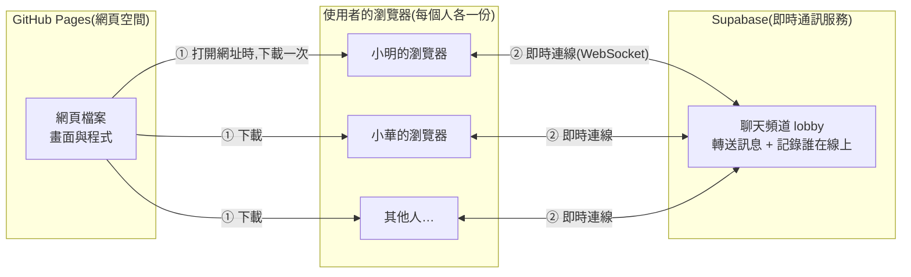

# 匿名聊天室架構文件

這份文件寫給不寫程式的人看。專有名詞第一次出現時,會用一句話解釋。文件裡沒有任何程式碼,只說明「做什麼、為什麼這樣做」。

---

## 1. 專案說明與目標

### 這是什麼

一個不用註冊、不用登入的匿名聊天室。任何拿到網址的人,用電腦或手機打開,輸入一個代號,就進到同一個聊天室,可以看到別人的訊息,也可以送出訊息。

### 目標

- 打開網頁、取個代號,十秒內就能開始聊天。
- 畫面上看得到誰在線上,有人進來或離開時有提示。
- 聊完就消失:訊息不保存在任何地方,新來的人看到的是空白畫面。
- 電腦和手機都好用。

### 已經和你確認過的使用規則

| 項目 | 規則 |
|---|---|
| 歷史訊息 | 不保存。新人進來是空白畫面 |
| 代號 | 1 到 12 個字,前後空格自動去掉,中文、英文、數字、emoji 都可以。線上不能重複,對方離線後別人可以用 |
| 訊息 | 純文字,最多 200 字,不能是空的。網址只顯示成文字,不能點。同一個人一秒只能送一則 |
| 送出方式 | 電腦按 Enter 送出,Shift+Enter 換行。手機按送出按鈕 |
| 線上名單 | 電腦版放在側邊。手機版平常只顯示「線上 N 人」,點開才看到名單 |
| 進出提示 | 在訊息之間插入灰色小字,例如「小明 進來了」 |
| 訊息排版 | 自己的訊息靠右,別人的靠左,顯示代號與時間,每個人有自己的顏色 |
| 重新整理或斷線 | 這個分頁記住代號,自動回到聊天室,並提示「已重新連線,中斷期間的訊息看不到」。每個分頁各記各的,互不影響。把分頁關掉再重新打開網址,要重新輸入代號 |
| 人數上限 | 同時最多 50 人。滿了會顯示「聊天室已滿,請稍後再來」 |
| 管理 | 沒有管理員,不能封鎖或檢舉 |
| 捲動 | 你停在最底部時,新訊息會自動捲上來。你往上看舊訊息時,畫面不會被拉走,底部會出現「有 N 則新訊息」按鈕 |
| 分頁提示 | 切到別的分頁時,分頁標題顯示未讀數,例如「(3) 匿名聊天室」。沒有提示音 |
| 氣氛 | 深夜公共空間的感覺,只做深色版。舊訊息往上捲出畫面時漸漸變淡,呼應「會消失」 |

---

## 2. 整體架構圖

先用白話說明三個角色:

- **瀏覽器**:使用者自己的 Chrome、Safari 之類的軟體。聊天室的畫面和操作都在這裡運作。
- **GitHub Pages**:GitHub 提供的免費網頁空間,只負責把網頁檔案交給瀏覽器,不處理聊天。
- **Supabase**:一個提供後端服務的網站(後端就是「在別人電腦上幫你處理資料的那一端」)。這個專案只用它的即時通訊功能,負責把一個人的訊息立刻轉給所有人。



怎麼看這張圖:

1. 使用者打開網址,瀏覽器從 GitHub Pages **下載一次**網頁檔案。之後 GitHub Pages 就沒事了。
2. 網頁一打開,瀏覽器會直接連到 Supabase。這條連線叫 **WebSocket**(一條開著不斷線的雙向通道,所以訊息可以馬上送達,不用一直重新整理)。
3. 所有人連到 Supabase 裡同一個「頻道」。有人送訊息,Supabase 立刻轉給頻道裡的每一個人。

**重點:這個專案沒有自己的伺服器,也沒有資料庫。** 訊息只是經過 Supabase 轉送,不會被存下來,所以才做得到「聊完就消失」。

---

## 3. 技術選擇

### 3.1 前端語言與框架

> **前端**:使用者在瀏覽器裡看到、操作的部分。**框架**:別人寫好的一套工具,幫忙把複雜網頁組織起來,例如 React、Vue。

**選了什麼:** 純 HTML、CSS、JavaScript,不用框架。三者分工是 HTML 決定畫面上有什麼、CSS 決定長什麼樣子、JavaScript 決定按下去會發生什麼事。

**為什麼:**

- 這個聊天室只有兩個畫面(輸入代號、聊天室),邏輯單純,用框架是殺雞用牛刀。
- 不用框架就**不需要「建置」這一步**(建置是把原始碼加工成可上線檔案的過程),檔案寫好就能直接放到 GitHub Pages,出問題的地方更少。
- 對你來說更好維護:裝的東西少,看到的就是實際運作的東西。

**代價:** 程式變大時要自己整理。所以第 4 節和第 11 節把程式拆成幾個小檔案,每個檔案只做一件事。

### 3.2 Supabase 用哪個功能

Supabase 有很多功能(資料庫、帳號登入、檔案儲存等)。這個專案**只用它的 Realtime**(即時通訊功能),其中兩個部分:

| 功能 | 白話說明 | 在這個專案做什麼 |
|---|---|---|
| **Broadcast** | 一個人喊話,頻道裡所有人都聽得到,Supabase 不會記下內容 | 傳送聊天訊息 |
| **Presence** | 每個人進頻道時舉手登記自己的狀態,離開或斷線時自動被劃掉,大家都能看到最新名單 | 線上名單、進出提示、斷線偵測 |

**為什麼這樣選:**

- Broadcast 不保存內容,正好符合「聊完就消失」。
- Presence 一個功能解決三件事:顯示誰在線上、知道誰進來或離開、偵測有人直接關掉網頁或網路斷掉(Supabase 過幾秒就會把他從名單移除)。不需要自己寫「定時確認你還在不在」的機制。

**刻意不用的:**

- **資料庫(Postgres Changes)**:要先把訊息寫進資料庫才能收到,和「不保存」相反。而且會牽涉資料表權限設定,增加不必要的複雜度。
- **帳號登入(Auth)**:需求明確寫了不需要登入。

---

## 4. 兩個階段

### 做法總覽

依照你的要求,先把前端做好並放上 GitHub Pages,最後才接 Supabase。整個設計圍繞一個概念:**把「怎麼收發訊息」獨立成一個可抽換的零件。**

> 做法類似手機充電:畫面是手機,「收發訊息的零件」是充電線。階段一用一條假的線,階段二換成真的線,手機本身不用改。

具體來說,畫面部分只會對這個零件下達以下指令,完全不知道零件背後是真的還是假的:

- 進入聊天室(帶著代號)
- 離開聊天室
- 送出訊息
- 零件會回報:收到訊息、有人進來、有人離開、線上名單變了、重新連線了(見第 5 節)

### 階段一:還沒接 Supabase

**要做到什麼程度:** 所有畫面、所有操作、所有提示都完整做好並可以操作,看起來和最終版完全一樣。

**怎麼做到:** 用一個「假的收發零件」,它不連網路,而是:

- 在**同一個瀏覽器的不同分頁之間**互傳訊息。你開兩三個分頁,就能自己扮演不同的人聊天,看到對方進來、離開、送訊息。
- 另外放幾個**假機器人**,定時說話、進出,讓你不用開很多分頁也能看到熱鬧的樣子,方便檢查捲動、淡出、未讀數等效果。

**在 GitHub Pages 上怎麼看到效果:** 把檔案放上 GitHub Pages(見第 12 節),打開網址就能操作。手機也能打開這個網址檢查版面。

**階段一的限制(要先知道):** 假零件只能在同一個瀏覽器內運作,所以你用電腦開的分頁和你手機上的畫面**不會互相看到對方**。真正跨裝置聊天要等階段二。這是預期中的,不是壞掉。

### 階段二:接上 Supabase

**改變的只有一件事:** 把「假的收發零件」換成「Supabase 版的收發零件」。畫面程式不用動。

階段二要做的事:

1. 在 Supabase 網站建立一個專案。
2. 取得專案的網址和公開金鑰(見第 8 節),填進設定檔。
3. 寫好 Supabase 版的收發零件,功能和假零件完全一樣。
4. 把畫面程式裡指向假零件的那一行,改成指向真零件。
5. 重新上傳到 GitHub Pages,用多個裝置實際測試。

階段二多出來的新行為:真正跨裝置、跨網路聊天;線上名單和進出提示來自真實的連線狀態;會遇到真實網路才有的情況(斷線、延遲、同時有人搶同一個代號)。

### 為什麼這樣設計就不用重寫

兩個階段的差別被限制在「一個零件」裡。畫面、輸入檢查、捲動、顏色、未讀數這些佔絕大部分工作量的東西,都只跟零件的「對外介面」溝通。只要新零件遵守相同介面,就可以直接換。這個介面就是第 5 節的「通訊約定」。

---

## 5. 通訊約定

這一節規定「零件」和「畫面」之間、以及「瀏覽器」和「Supabase」之間說話的格式。假零件和真零件都要遵守同一份約定,這就是兩個階段能順利銜接的關鍵。

### 5.1 頻道

- 全部的人在同一個頻道,名稱固定為 **lobby**。

### 5.2 在網路上傳送的資料(Supabase 版會用到)

**聊天訊息**:用 Broadcast 傳送,事件名稱叫 **message**。內容包含:

| 欄位 | 意思 | 範例 |
|---|---|---|
| id | 這則訊息的唯一編號,避免重複顯示 | 一串隨機字元 |
| nickname | 送出者的代號 | 小明 |
| text | 訊息內容 | 大家好 |
| sentAt | 送出的時間 | 一個時間戳記 |

**線上狀態**:用 Presence 登記,每個人登記的內容包含:

| 欄位 | 意思 | 範例 |
|---|---|---|
| nickname | 我的代號 | 小明 |
| joinedAt | 我進來的時間(用來在同時搶代號時判斷誰先) | 一個時間戳記 |

「有人進來」和「有人離開」**不是額外傳送的訊息**,而是 Presence 名單變化時,畫面自己推算出來的。這樣即使有人直接關掉網頁,其他人也會看到「離開了」。

### 5.3 零件回報給畫面的事件(兩個階段共用)

| 事件名稱 | 什麼時候發生 | 附帶資料 |
|---|---|---|
| onMessage | 收到一則聊天訊息(包含自己送出的) | 代號、內容、時間 |
| onJoin | 有人進來 | 代號 |
| onLeave | 有人離開 | 代號 |
| onRosterChange | 線上名單有變 | 目前所有人的代號清單 |
| onReconnect | 斷線後重新連上了 | 無 |
| onKicked | 重新連線後,發現自己的代號已被別人占走 | 無 |

### 5.4 畫面對零件下達的指令

| 指令 | 做什麼 | 可能的結果 |
|---|---|---|
| join(代號) | 進入聊天室 | 成功;或失敗,原因是「代號重複」或「聊天室已滿」 |
| send(內容) | 送出訊息 | 無回傳,送出後會從 onMessage 收到 |
| leave() | 離開聊天室 | 無 |

**自己的訊息也從 onMessage 回來**:送出的人也是等 onMessage 事件才在畫面上顯示。這樣「自己看到的」和「別人看到的」永遠一致,不會出現自己看得到但別人收不到的情況。

---

## 6. 資料流

以下用「誰做了什麼、接著發生什麼」說明四種情況。

### 6.1 進入聊天室

1. 使用者打開網頁。瀏覽器先檢查這個分頁有沒有記住代號(記在 **sessionStorage**:瀏覽器提供的小儲存空間,**每個分頁各有一本,互相看不到**。重新整理分頁時還在,把分頁關掉就消失)。
   - 有記住:直接跳到第 3 步。
   - 沒有:顯示輸入代號的畫面。
2. 使用者輸入代號。網頁先檢查格式(不能空白、不超過 12 字),不符合就在輸入框下方提示原因,不會往下走。
3. 瀏覽器連上 Supabase 的 lobby 頻道,並等待取得「目前的線上名單」。
4. 網頁檢查兩件事:
   - 線上是否已有 50 人?是的話顯示「聊天室已滿」,退出頻道。
   - 名單裡是否已有相同代號?是的話提示「這個代號有人用了,請換一個」,退出頻道。
5. 都通過後,登記自己到名單(Presence),把代號存進這個分頁的 sessionStorage,畫面切到聊天室。
6. 所有人的畫面都因為名單變化而更新線上名單,並插入「某某 進來了」。
7. **小漏洞:** 如果兩個人在同一瞬間輸入同一個代號,可能都通過第 4 步。補救辦法是登記之後再檢查一次,如果同代號出現兩筆,「進來時間較晚」的人被請出並提示重取。這樣做不能 100% 排除,但發生機率極低,後果也只是短暫出現兩個同名的人。

### 6.2 送出訊息

1. 使用者按 Enter(手機按送出鈕)。
2. 網頁檢查:是否空白?是否超過 200 字?距離上次送出是否超過一秒?任何一項不符合,就不送出,並在輸入框附近簡短提示。
3. 通過後,把訊息(第 5.2 節的格式)交給 Supabase,Supabase 立刻轉給頻道裡的所有人,包含送出者自己。
4. 每個人的瀏覽器收到訊息後,**先檢查再顯示**(見第 9 節),然後加到訊息列表。
5. 捲動行為:如果這個人正停在最底部就自動捲到底;如果他正在往上看舊訊息就不動,改顯示「有 N 則新訊息」按鈕。若這則訊息是他自己送的,一律捲到底。
6. 如果這個人目前切到別的分頁,分頁標題的未讀數加一。

### 6.3 離開

兩種情況:

**主動離開(按「離開」按鈕):**

1. 瀏覽器告訴 Supabase 退出頻道。
2. 清掉這個分頁的 sessionStorage 裡記住的代號(只影響這個分頁,其他分頁不受影響)。
3. 畫面回到輸入代號的畫面。
4. 其他人看到「某某 離開了」,線上名單更新,人數減一。

**直接關閉網頁:**

1. 瀏覽器沒機會說再見,連線直接消失。
2. Supabase 發現這個人的連線不見了,幾秒內把他從名單移除。
3. 其他人看到「某某 離開了」。分頁被關掉時,這個分頁的 sessionStorage 也一起消失,所以他下次打開網址要重新輸入代號。(只是重新整理的話,sessionStorage 還在,會自動回來,見 6.4。)

### 6.4 斷線重連

例如手機切到別的 App 一陣子,網路中斷。

1. 網路斷掉期間,畫面不會當機,可以顯示「連線中斷」的狀態。
2. 網路恢復後,Supabase 的函式庫會**自動嘗試重連**。
3. 重連成功:重新把自己登記到名單,並在訊息列表插入一行「已重新連線,中斷期間的訊息看不到」。
4. 中斷期間別人說的話**補不回來**,因為訊息本來就沒有被保存。這是「聊完就消失」的必然結果。
5. 如果重連時發現自己的代號已被別人占走(在你離線期間,Supabase 已經把你視為離開,別人用了這個代號):只清掉這個分頁自己的 sessionStorage,回到輸入代號的畫面,並提示「你的代號已被使用,請重新取一個」。其他分頁不受影響。

**複製分頁的情況:** 用瀏覽器的「複製分頁」功能時,新分頁會連同 sessionStorage 一起複製,所以它會用同一個代號嘗試進入。如果原分頁還在線上,新分頁會被判定代號重複,回到輸入畫面讓使用者重取。這是正確的行為,也只影響新分頁。

---

## 7. 畫面清單

只說明有什麼元素、按了會怎樣,不規定顏色和樣式(那是 /design 的工作)。

### 畫面 A:輸入代號

| 元素 | 行為 |
|---|---|
| 標題與一句簡短說明 | 純顯示 |
| 代號輸入框 | 輸入時即時顯示目前字數(例如 3/12)。自動去掉前後空格 |
| 進入按鈕 | 代號格式不合格時不能按。按下後進入「連線中」狀態,避免重複按 |
| 錯誤提示區 | 顯示原因:空白、太長、代號有人用了、聊天室已滿、連線失敗 |
| 連線中狀態 | 按鈕顯示處理中,輸入框暫時鎖住 |

### 畫面 B:聊天室

**頂部列**

| 元素 | 行為 |
|---|---|
| 聊天室名稱 | 純顯示 |
| 「線上 N 人」 | 手機版:點了展開線上名單面板。電腦版:純顯示,因為名單已經在側邊 |
| 離開按鈕 | 按下後清掉記住的代號,回到畫面 A |
| 連線狀態 | 斷線時顯示「連線中斷,嘗試重新連線…」,恢復後自動消失 |

**訊息列表(畫面的主體)**

| 元素 | 行為 |
|---|---|
| 一般訊息 | 顯示代號、內容、時間。自己的靠右、別人的靠左。每個代號有固定的顏色。新訊息淡入。網址只顯示成文字,不可點擊 |
| 系統提示 | 灰色小字,例如「小明 進來了」、「小明 離開了」、「已重新連線,中斷期間的訊息看不到」。不是真人說的話,排版上要明顯不同 |
| 空狀態 | 剛進來沒有任何訊息時,顯示簡短提示,例如「還沒有人說話」 |
| 舊訊息變淡 | 訊息往上捲出畫面時漸漸變淡。這只是視覺效果,不是真的刪除。畫面上最多保留最近 200 則,更舊的直接移除 |
| 「有 N 則新訊息 ↓」按鈕 | 只在你往上看舊訊息、此時又有新訊息進來時出現。按下去回到最底部並消失 |

**線上名單**

| 元素 | 行為 |
|---|---|
| 名單 | 顯示所有線上的代號(各自帶自己的顏色),自己的代號有標示。有人進出時即時更新 |
| 電腦版 | 固定在側邊 |
| 手機版 | 平常收起;點頂部「線上 N 人」才以面板展開;再點一次或點面板外關閉 |

**底部輸入區**

| 元素 | 行為 |
|---|---|
| 文字輸入框 | 最多 200 字,顯示剩餘字數。電腦:Enter 送出,Shift+Enter 換行。手機:Enter 就是換行 |
| 送出按鈕 | 內容空白時不能按。手機主要靠它送出 |
| 提示 | 送太快、太長時,在輸入框附近簡短說明原因 |
| 位置 | 固定在畫面底部,手機鍵盤彈出時不能被遮住 |

### 畫面 C:聊天室已滿

可以是畫面 A 上的一則提示,不需要獨立的整頁。內容:「聊天室已滿,請稍後再來」,附一個「重試」按鈕,按下去重新嘗試進入。

### 分頁標題

不是獨立畫面,但屬於畫面行為:使用者切到別的分頁時,有新訊息就在標題前加未讀數,例如「(3) 匿名聊天室」;切回來就清掉。

---

## 8. 金鑰

### 8.1 這個專案會用到哪些金鑰

在 Supabase 建立專案後,你會看到下面這些東西。**這個專案實際只會用到前兩項:**

| 名稱 | 是什麼 | 這個專案用嗎 | 可以公開嗎 |
|---|---|---|---|
| **專案網址(Project URL)** | 你的 Supabase 專案的網址,告訴瀏覽器要連去哪裡 | 用 | 可以 |
| **公開金鑰(anon key,新版介面可能叫 publishable key)** | 給瀏覽器用的「通行證」,只能做你允許的事,例如連上即時通訊頻道 | 用 | **可以**,而且一定會被公開(見下方說明) |
| **管理金鑰(service_role key,新版可能叫 secret key)** | 萬能鑰匙,可以跳過所有權限限制,讀寫整個專案 | **不用** | **絕對不行** |
| 資料庫密碼 | 直接連資料庫用的密碼 | 不用 | 絕對不行 |

### 8.2 為什麼公開金鑰可以公開

因為它的設計目的就是給瀏覽器使用。任何人打開你的網頁,按右鍵「檢視原始碼」都一定看得到它,不可能藏起來。這是正常的,不是外洩。它能做的事被 Supabase 限制住了,不能用它管理專案或刪除東西。

### 8.3 怎麼產生

不用自己產生。建立 Supabase 專案時,系統會自動配好。你只需要:

1. 登入 Supabase 網站,建立一個新專案(免費方案即可)。
2. 進入專案設定,找到 API 相關的頁面。
3. 把「專案網址」和「公開金鑰」複製下來。

(實際的畫面位置可能隨 Supabase 改版而不同,階段二到了這一步我們再一起對照畫面操作。)

### 8.4 放在哪裡

- 放在 `js/config.js` 這個設定檔裡,只放**專案網址**和**公開金鑰**這兩項。
- 因為它們本來就可以公開,這個檔案**可以**提交到 GitHub,不需要特別的保護機制,也不需要 GitHub 的「Secrets」功能(Secrets 是 GitHub 用來存機密內容的保險箱)。

### 8.5 絕對不能公開的,怎麼避免被提交到 GitHub

**首先:這個專案根本用不到管理金鑰和資料庫密碼,所以最好的防護是「完全不要把它們帶進這個專案資料夾」。** 你不需要複製、不需要貼在任何檔案裡。

另外,為了萬一誤放,做三道保險:

1. **`.gitignore` 檔案**:這是一份「清單」,告訴 git(管理程式版本的工具)哪些檔案不要上傳。我們會在裡面列入 `.env`、`.env.*`、`*.key`、`secrets*` 這類常見存放機密的檔名。
2. **提交前自己檢查**:每次提交前看一下變更清單,若看到不認識的檔案或內容裡有 `service_role`、`secret` 之類的字,不要提交。
3. **萬一不小心貼進去並上傳了:** 立刻到 Supabase 專案設定**重新產生**(rotate)那把金鑰,舊的立即失效。因為 git 會保留歷史紀錄,光是刪掉檔案不夠,一定要換新鑰匙。

---

## 9. 安全與限制

### 9.1 先講一個前提

因為沒有自己的伺服器,所有規則(一秒一則、200 字、12 字代號、50 人上限、代號不重複)都是**在每個人的瀏覽器裡檢查**。懂技術的人可以繞過網頁,直接對 Supabase 發送資料,而不受這些規則限制。

這對一個不保存資料、不重要的小聊天室是可以接受的。收訊息的一方會再檢查一次(下面說明),避免畫面被弄壞。如果日後需要真正擋得住的限制,要加一層自己的伺服器程式,那是另一個階段的工作,這一版不做。

### 9.2 別人可能送進來的奇怪東西,以及前端怎麼擋

| 可能的狀況 | 前端怎麼處理 |
|---|---|
| 訊息裡塞網頁程式碼,例如 `<script>`,企圖在別人的畫面執行(這種攻擊叫 **XSS**) | 收到的內容一律當成「純文字」放進畫面,瀏覽器不會把它當程式執行。這是最重要的一道防線 |
| 超長訊息(遠超過 200 字) | 收到後檢查長度,超過就丟棄,不顯示 |
| 空白或只有空格的訊息 | 收到後檢查,丟棄 |
| 資料格式不對、缺欄位、欄位型態錯誤 | 收到後檢查格式,不完整就丟棄,不讓畫面出錯 |
| 假冒別人:送出的代號不在線上名單裡 | 收到訊息時對照目前線上名單,不在名單上的代號就丟棄 |
| 洗版:短時間送大量訊息 | 自己的瀏覽器限制一秒一則。收訊息的一方也限制:同一個代號超過每秒一則的部分直接忽略 |
| 奇怪的代號:全空格、超長、控制字元 | 進入時檢查;收到別人的名單與訊息時再檢查一次,不合格就不顯示 |
| 看起來像別人的代號(例如多一個空格、全形半形差異) | 判斷「重複」時先統一格式(去空格、忽略大小寫與全形半形差異)再比較 |
| 把網址或惡意連結貼進訊息 | 網址只當文字顯示,不做成可點擊的連結 |

### 9.3 Supabase 免費方案的上限

免費方案對即時通訊功能有一些用量限制,**這裡寫的數字是撰寫時的大致印象,實際數字請以 Supabase 官網的價格頁面與文件為準**,階段二開始前我們會一起確認:

- **同時連線人數**:有上限(大約在兩百人的等級)。我們設的 50 人上限遠低於它,也能避免被洗到超量。
- **每秒訊息量**:整個專案和每個連線都有每秒訊息數上限。一秒一則的限制是為了不要碰到它。
- **單則訊息大小**:有上限,但 200 字遠遠低於。
- **專案閒置會被暫停**:免費專案若很久沒人使用,Supabase 可能暫停它。暫停後網頁會連不上,要到 Supabase 後台手動恢復。
- **每月總用量**:有額度。個人小聊天室通常用不完,但若連結被大量散播就可能超量。

超過上限時可能發生的現象:連不上、訊息延遲、被擋下。畫面要能呈現「連線失敗,請稍後再試」的狀態,而不是整個當掉。

---

## 10. 這一版刻意不做的事

| 不做 | 為什麼 |
|---|---|
| 註冊、登入 | 需求明確說不需要,也是「匿名」的核心 |
| 保存歷史訊息 | 你想要「聊完就消失」的感覺;不保存也省掉資料庫的設定與權限管理 |
| 新人看到最近的訊息 | 同上 |
| 管理員、封鎖、檢舉、關鍵字過濾 | 沒有伺服器就沒辦法做出真正有效的管理;做半套反而給人錯誤的安全感 |
| 私訊、多個房間 | 需求是「所有人在同一個聊天室」 |
| 圖片與檔案 | 純文字最單純,也避免不當內容與用量問題 |
| 可點擊的網址 | 避免有人貼惡意連結讓別人誤點 |
| 提示音、瀏覽器通知 | 保持安靜、低調的氣氛 |
| 淺色主題 | 風格決定只做深夜深色版,少維護一套 |
| 自己的伺服器程式 | 讓整個專案維持在「兩個免費服務就能運作」,最簡單、最省錢 |
| 補回斷線期間漏掉的訊息 | 因為不保存,本來就補不回來 |

---

## 11. repo 的資料夾結構

> **repo**(儲存庫)就是這個專案在 GitHub 上的整個資料夾。

```
anonymous-chat1/
├── index.html             網頁的入口,使用者打開網址看到的就是它
├── .gitignore             告訴 git 哪些檔案不要上傳(見第 8.5 節)
├── css/
│   └── style.css          外觀樣式(由 /design 與 /frontend-design 決定內容)
├── js/
│   ├── config.js          Supabase 的專案網址與公開金鑰(階段二才填)
│   ├── main.js            總指揮:決定現在顯示哪個畫面,把各零件串起來
│   ├── validate.js        檢查規則:代號、訊息是否合格
│   ├── transport-mock.js  階段一用的「假收發零件」
│   ├── transport-supabase.js  階段二用的「真收發零件」(階段二才建立)
│   ├── ui.js              更新畫面:訊息列表、線上名單、捲動、未讀數
│   └── color.js           決定每個代號顯示什麼顏色
├── tests/                 驗證檢查規則是否正確的測試(可選)
└── docs/
    ├── requirements.md    需求說明
    └── architecture.md    本文件
```

各檔案的職責:

- **`validate.js`** 只做「判斷對不對」,不碰畫面也不碰網路,最容易單獨測試。
- **`transport-mock.js` 與 `transport-supabase.js`** 遵守第 5 節同一份約定,是可抽換的零件。
- **`main.js`** 是唯一知道「現在用的是哪一個零件」的地方,階段二只要改這裡的一行。

---

## 12. 部署到 GitHub Pages 的方式

> **部署**就是把做好的網站放到網路上,讓別人用網址打開。

**為什麼不需要任何建置流程:** 第 3.1 節選了純 HTML/CSS/JS,檔案本身就是最終成品,不需要加工。

**步驟:**

1. 把所有檔案提交到 GitHub 的 `main` 分支。
2. 到 GitHub 的 repo 頁面,進入 Settings(設定)裡的 Pages 設定。
3. 來源選擇 `main` 分支的根目錄。
4. 等幾分鐘,GitHub 會顯示網址,格式是 `https://<你的帳號>.github.io/<repo 名稱>/`。
5. 之後每次更新並提交到 `main`,網站會自動更新(可能要等一兩分鐘)。

**要注意的兩件事:**

- **網址是帶有 repo 名稱的子路徑**,所以網頁裡引用檔案時要用相對路徑(例如 `js/main.js`,不要寫成 `/js/main.js`),否則網頁會找不到檔案。
- GitHub Pages 的內容是**公開**的,任何知道網址的人都能看到所有檔案。這也是為什麼機密金鑰絕對不能放進專案。

階段一和階段二都用同樣的方式部署,階段二只是更新了其中幾個檔案。

---

## 13. 驗證清單

### 階段一:還沒接 Supabase(假零件)

**輸入代號**

- [ ] 空白、只有空格的代號不能進入,並顯示原因
- [ ] 超過 12 字的代號不能進入,並顯示原因
- [ ] 前後空格自動去掉
- [ ] 中文、英文、數字、emoji 的代號都能進入
- [ ] 同一個瀏覽器開兩個分頁輸入相同代號,第二個被擋下並提示;第一個離開後,可以使用該代號

**訊息**

- [ ] 空白訊息送不出去
- [ ] 超過 200 字送不出去,有提示
- [ ] 一秒內連按兩次只送出一則,有提示
- [ ] 電腦:Enter 送出、Shift+Enter 換行。手機:用按鈕送出
- [ ] 輸入 `<b>test</b>` 或 `<script>` 這類內容,畫面顯示原本的文字,不會變粗體或執行
- [ ] 貼上網址,只顯示成文字,不能點
- [ ] 自己的訊息靠右、別人的靠左,顯示代號與時間,每個代號顏色固定

**線上與提示**

- [ ] 另一個分頁加入或離開時,本頁出現「進來了」「離開了」提示
- [ ] 線上名單與「線上 N 人」同步更新
- [ ] 新人進來是空白畫面,看不到之前的訊息
- [ ] 模擬滿 50 人時,第 51 位看到「聊天室已滿」

**重新整理與離開**

- [ ] 重新整理後自動回到聊天室,並顯示重新連線提示
- [ ] 按「離開」後重新整理,回到輸入代號畫面

**捲動與提示**

- [ ] 停在底部時,新訊息自動捲到底
- [ ] 往上看舊訊息時,畫面不被拉走,並出現「有 N 則新訊息」按鈕;按下去回到底部
- [ ] 自己送出訊息時一定捲到底
- [ ] 切到別的分頁時,標題顯示未讀數;切回來後清掉
- [ ] 舊訊息往上捲出畫面時漸漸變淡

**版面與部署**

- [ ] 電腦寬度:線上名單固定在側邊
- [ ] 手機寬度:名單收起,點「線上 N 人」才展開,可以關閉
- [ ] 手機鍵盤彈出時,輸入框不被遮住
- [ ] 系統設定「減少動態效果」開啟時,淡入淡出效果被關閉
- [ ] 已放上 GitHub Pages,用網址能正常打開,檔案都有載入(沒有因路徑錯誤而空白)
- [ ] 電腦與手機都能用網址打開並操作

### 階段二:接上 Supabase(真零件)

**接線確認**

- [ ] 專案網址與公開金鑰已填入 `config.js`
- [ ] 專案資料夾中沒有出現管理金鑰與資料庫密碼(搜尋 `service_role`、`secret` 確認)
- [ ] `.gitignore` 已包含機密檔案類型

**真實跨裝置聊天**

- [ ] 電腦與手機(不同網路,例如手機用行動網路)進入同一個聊天室,互相看得到訊息
- [ ] 訊息在一兩秒內送達
- [ ] 手機與電腦的線上名單一致,人數正確
- [ ] 一方進入或離開,另一方看到提示
- [ ] 一方直接關閉網頁,另一方在幾秒內看到「離開了」並更新名單

**代號與人數**

- [ ] 兩個不同裝置輸入相同代號,後來的被擋下
- [ ] 一方離開後,該代號可以被使用
- [ ] 兩個裝置同時輸入同一代號,最終只留下一個(第 6.1 節的補救機制)
- [ ] 達到 50 人時,第 51 位看到「聊天室已滿」(可用腳本或多個分頁協助模擬)

**斷線與重連**

- [ ] 手機關閉網路再打開,自動重連,並顯示「已重新連線,中斷期間的訊息看不到」
- [ ] 斷線期間別人說的話,重連後確實看不到(符合預期)
- [ ] 斷線很久、代號被別人占走時,回到輸入畫面並提示重取
- [ ] 重新整理分頁後,自動用同一代號回來
- [ ] 把分頁關掉再重新打開網址,回到輸入代號畫面(不會自動進入)
- [ ] 同一個瀏覽器開兩個分頁,輸入不同代號,兩邊互不影響;其中一個分頁按「離開」或被請出,另一個分頁仍留在聊天室
- [ ] 按「離開」後再打開,回到輸入畫面

**安全與限制**

- [ ] 兩個真實裝置之間送 `<b>test</b>` 這類內容,雙方畫面都顯示原本文字
- [ ] 畫面對格式不正確或過長的資料不會當機(可用開發人員工具手動送入測試)
- [ ] 沒有人在線上一陣子後再進入,聊天室仍是空白畫面(確認訊息沒有被保存)
- [ ] Supabase 連不上時(例如專案被暫停、填錯金鑰),畫面顯示明確的失敗提示,而不是整頁空白
- [ ] Supabase 後台確認沒有建立任何資料表,也沒有存下訊息內容
